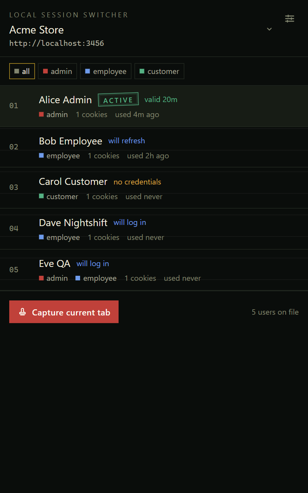
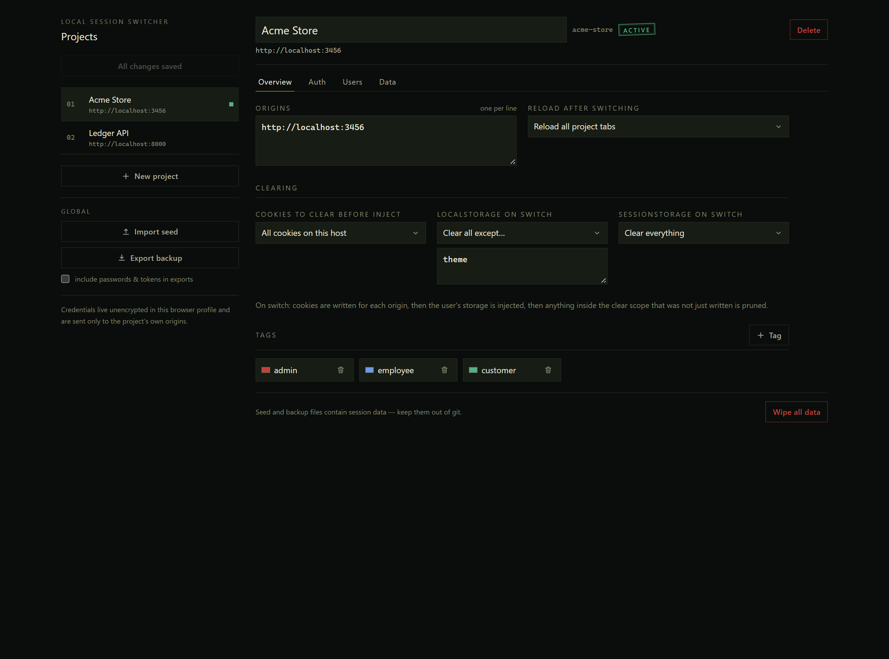

# Local Session Switcher

[](https://github.com/abdallahsaber065/local-session-switcher/actions/workflows/ci.yml)
[](LICENSE)

Chrome MV3 extension that swaps test-user sessions (cookies + localStorage/sessionStorage) on local projects.



## Why

Local projects usually share the same origin (`http://localhost:3000`), so they share cookies and storage. This extension keeps named user profiles per project and swaps the whole session in one click:

1. Writes the selected user's cookies + storage.
2. Prunes everything else in the project's configured clear scope.
3. Reloads the project's tabs.

Project selection is manual and persisted — it is never derived from the URL. Press <kbd>Alt</kbd>+<kbd>Shift</kbd>+<kbd>U</kbd> / <kbd>Alt</kbd>+<kbd>Shift</kbd>+<kbd>Y</kbd> to cycle users, or right-click → Session Switcher.

## Seed authoring skill

This repo ships `skills/session-switcher-seed/` — an agent skill that helps someone author a
**full, correct seed file** for a project (origins, clearing rules, auth recipe with
login/refresh/preflight, tagged test users) and validates it before import. Install it for your
agent by copying the folder into its skills directory, e.g.:

```bash
# Claude Code / generic agents
cp -r skills/session-switcher-seed ~/.claude/skills/
# or for agents using ~/.agents/skills
cp -r skills/session-switcher-seed ~/.agents/skills/
```

Then ask things like "create a session-switcher seed for my NextAuth app on localhost:3000 with
admin and customer test users". The skill runs `scripts/validate-seed.mjs` before handing the
file over; you can also validate any seed manually:

```bash
node skills/session-switcher-seed/scripts/validate-seed.mjs my-project.seed.json
```

`skills/session-switcher-seed/assets/example.seed.json` is a complete, import-ready example.

## Development

```bash
pnpm install
pnpm dev          # Chrome dev build with HMR → load .output/chrome-mv3-dev unpacked
pnpm test         # unit tests (planner / schema / seed merge)
pnpm compile      # type-check
pnpm build        # production build → .output/chrome-mv3
pnpm zip          # Chrome Web Store zip
```

Load unpacked: `chrome://extensions` → Developer mode → Load unpacked → `.output/chrome-mv3-dev` (or `chrome-mv3`).

## Using it

1. **Settings** (popup → Settings): create a project with its origins (e.g. `http://localhost:3000`), or import a seed file.
2. Log in manually on the project tab.
3. Popup → **Capture current tab as user** → name and tag it.
4. Repeat for each test user; switch any time by clicking a user row.

Settings — project rail, tabs for Overview / Auth / Users / Data:



`test-harness/index.html` is a fake login page for trying this without a real project:

```bash
pnpm dlx serve test-harness -l 3456   # then log in as Alice/Bob/Carol
```

### Config / seed JSON

Everything is editable as JSON (Settings → Raw JSON per project, or backup/seed import). Shape:

```jsonc
{
  "schemaVersion": 1,
  "projects": [
    {
      "id": "my-app",
      "name": "My App",
      "origins": ["http://localhost:3000", "http://127.0.0.1:8000"],
      "tags": [{ "name": "admin", "color": "#ef4444" }],
      "clear": {
        "cookies": "all",                                        // or { "names": [] } / { "prefixes": [] }
        "localStorage": { "mode": "all", "exclude": ["theme"] }, // or { "mode": "keys", "keys": [] }
        "sessionStorage": "all"
      },
      "reload": "matching-tabs",                                 // | "active-tab" | "none"
      "users": [
        {
          "id": "u-admin",
          "name": "Admin",
          "tags": ["admin"],
          "cookies": [{ "name": "session", "value": "…", "path": "/", "hostOnly": true }],
          "storage": { "http://localhost:3000": { "localStorage": { "token": "…" }, "sessionStorage": {} } }
        }
      ]
    }
  ]
}
```

Seed import merges: projects by `id`/`name`, users by `id`/`name` (seed wins); missing user ids are generated and missing fields get defaults.

## How a switch works

1. Read current cookies for each project host.
2. Plan (pure function in `lib/planner.ts`): cookies to set, cookies to remove (clear scope minus the new session), storage writes + prune rules.
3. Execute: set new cookies → write storage in every matching tab (or queue a pending injection when no tab is open) → prune leftovers → reload per project setting.

The session always transitions A → B; it is never fully cleared in between, so auth guards don't see a logged-out flash more than necessary. Badge shows the active user's initials; the popup marks the detected active user.

## Permissions

`storage`, `cookies`, `contextMenus`, `sidePanel` + host permissions for `localhost` / `127.0.0.1` (http and https). No network requests — everything stays in `chrome.storage.local`.

## Contributing

PRs welcome — see [CONTRIBUTING.md](CONTRIBUTING.md). Vulnerabilities: see
[SECURITY.md](SECURITY.md) (use private reporting, not public issues).

## License

MIT — see [LICENSE](LICENSE).

## Notes & limits

- Chrome shares cookies across all ports of a host, so one user can be active per browser profile. For two users at once, use a second Chrome profile or an incognito window (allow the extension in incognito).
- IndexedDB is intentionally never touched.
- `chrome.storage.local` is not encrypted — don't store production secrets here.
- Seed/backup files contain live tokens; `*.seed.json` is gitignored.
- Only localhost / 127.0.0.1 hosts are permitted; extend `host_permissions` in `wxt.config.ts` for other hosts.
