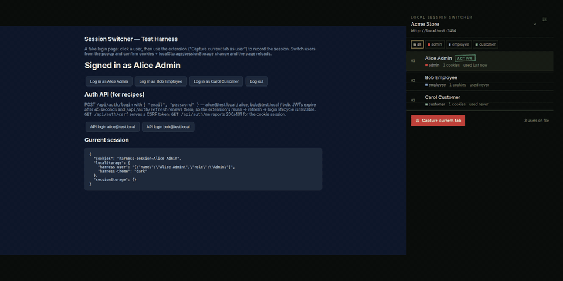
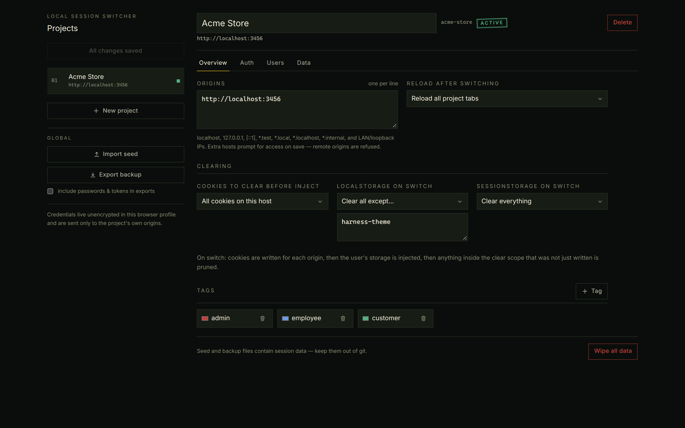
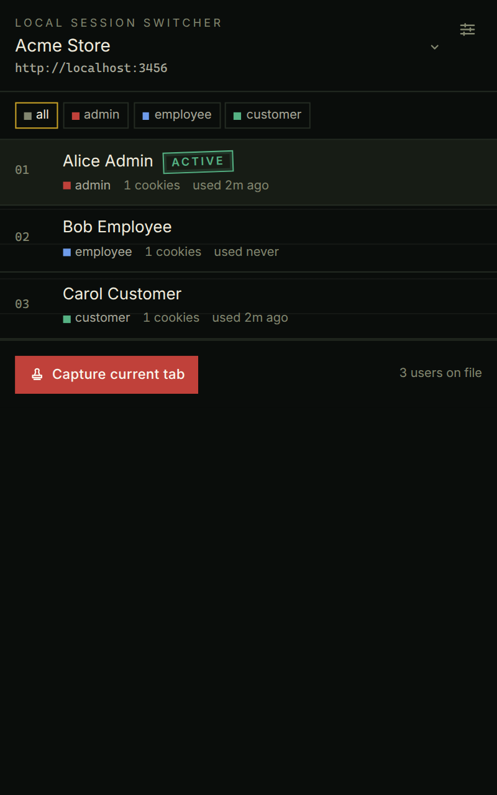

# Local Session Switcher

[](https://github.com/abdallahsaber065/local-session-switcher/actions/workflows/ci.yml)
[](https://github.com/abdallahsaber065/local-session-switcher/releases/latest)
[](LICENSE)

**One-click test-user switching for apps on localhost.**

Every local project shares one cookie jar. This Chrome MV3 extension keeps named
users per project (admin, employee, customer) and swaps cookies plus
`localStorage` / `sessionStorage` in one click. Tabs reload. No sign-out dance.
Nothing leaves your machine.

Homepage: [abdallahsaber065.github.io/local-session-switcher](https://abdallahsaber065.github.io/local-session-switcher/)



## Why it exists

Local apps all live on `localhost`, so they share cookies and storage. Testing a
role-based app means logging out and back in, juggling incognito windows, or
pasting tokens into DevTools. Chrome profiles work for two users and fall apart
at five roles across three projects.

Local Session Switcher treats the **project** as the scope, not the URL — because
the URL (`http://localhost:3000`) tells you nothing. You pick the project once;
it is remembered.

## Features

- **Project-scoped user lists** — picked manually and persisted, never inferred from the URL.
- **One-click session swap** — cookies + `localStorage`/`sessionStorage` written, stale auth pruned, tabs reloaded. The session goes A → B, never through a logged-out wipe.
- **Auth recipes** — reuse → refresh → login with CSRF preflights. A failed login aborts before touching the browser.
- **Capture or seed** — grab a live session, or import a JSON seed (standalone validator included). An [agent skill](skills/session-switcher-seed/SKILL.md) can author the seed from your auth code.
- **Test-user awareness** — role tags, JWT expiry countdown, active-user detection, toolbar badge with initials.
- **Keyboard-first** — <kbd>Alt</kbd>+<kbd>Shift</kbd>+<kbd>U</kbd> / <kbd>Y</kbd> to cycle users, right-click menu, side panel.
- **Extra local hosts** — `*.test`, `*.local`, `*.localhost`, `*.internal`, and LAN/loopback IPs, requested only when you add them. Remote hosts are refused.
- **Local-only** — no analytics, no servers. Recipe URLs are origin-guarded to the project's own origins.

Works in **Chrome**, **Brave**, and other Chromium browsers.

## Supported auth presets

Starting points in Settings → Auth — edit URLs and field names to match the project.

| Preset | Typical stack |
|---|---|
| Session cookie | Express / Passport / Rails |
| NextAuth credentials | Next.js `credentials` provider (CSRF preflight) |
| Laravel Sanctum | SPA + `sanctum/csrf-cookie` |
| Django session | CSRF form login |
| JWT + refresh | Access token in `localStorage`, refresh endpoint |

2FA / social / OTP logins stay manual: sign in once, then **Capture current tab**.

## Install

### From a GitHub Release (current)

1. Download `local-session-switcher-*.zip` from the [latest Release](https://github.com/abdallahsaber065/local-session-switcher/releases/latest).
2. Unzip it.
3. Open `chrome://extensions` → enable **Developer mode** → **Load unpacked** → pick the unzipped folder.

### Chrome Web Store

Store listing is in progress. This section will get the install link when review completes.

<!-- When live: [Install from the Chrome Web Store](https://chromewebstore.google.com/detail/…) -->

### From source

```bash
pnpm install && pnpm build
```

Then load unpacked from `.output/chrome-mv3`.

## Quick start

```bash
node test-harness/server.mjs   # fake login page + auth API on http://localhost:3456
```

1. Open `http://localhost:3456` and click **Log in as Alice Admin**.
2. Popup → Settings: create a project with origin `http://localhost:3456`, or import [`skills/session-switcher-seed/assets/example.seed.json`](skills/session-switcher-seed/assets/example.seed.json) (point its origins at `:3456` if you use the harness as-is).
3. Popup → **Capture current tab** → name it Alice, tag `admin`.
4. On the harness, log in as Carol Customer and capture her too.
5. Click a user in the popup. The tab reloads as that user.

Keyboard: <kbd>Alt</kbd>+<kbd>Shift</kbd>+<kbd>U</kbd> next user, <kbd>Alt</kbd>+<kbd>Shift</kbd>+<kbd>Y</kbd> previous.

Settings — project rail, tabs for Overview / Auth / Users / Data:



Popup — ledger of test users with live session states:



## Config / seed JSON

Everything is editable as JSON (Settings → Raw JSON per project, or backup/seed import). Shape:

```jsonc
{
  "schemaVersion": 1,
  "projects": [
    {
      "id": "my-app",
      "name": "My App",
      "origins": ["http://localhost:3000", "http://127.0.0.1:8000"],
      "tags": [{ "name": "admin", "color": "#ef4444" }],
      "clear": {
        "cookies": "all",                                        // or { "names": [] } / { "prefixes": [] }
        "localStorage": { "mode": "all", "exclude": ["theme"] }, // or { "mode": "keys", "keys": [] }
        "sessionStorage": "all"
      },
      "reload": "matching-tabs",                                 // | "active-tab" | "none"
      "users": [
        {
          "id": "u-admin",
          "name": "Admin",
          "tags": ["admin"],
          "cookies": [{ "name": "session", "value": "…", "path": "/", "hostOnly": true }],
          "storage": { "http://localhost:3000": { "localStorage": { "token": "…" }, "sessionStorage": {} } }
        }
      ]
    }
  ]
}
```

Seed import merges: projects by `id`/`name`, users by `id`/`name` (seed wins); missing user ids are generated and missing fields get defaults.

A complete import-ready example: [`skills/session-switcher-seed/assets/example.seed.json`](skills/session-switcher-seed/assets/example.seed.json). Validate any seed:

```bash
node skills/session-switcher-seed/scripts/validate-seed.mjs my-project.seed.json
```

### Seed authoring skill

Copy `skills/session-switcher-seed/` into your agent's skills directory:

```bash
cp -r skills/session-switcher-seed ~/.claude/skills/
# or
cp -r skills/session-switcher-seed ~/.agents/skills/
```

Then ask: "create a session-switcher seed for my NextAuth app on localhost:3000 with admin and customer test users". Schema reference: [`skills/session-switcher-seed/references/schema.md`](skills/session-switcher-seed/references/schema.md).

## Extra local hosts (Valet, Herd, `*.local`, LAN)

Default host permission is `localhost`, `127.0.0.1`, and `[::1]`. If the app is on
`http://myapp.test` (Laravel Valet/Herd), `http://app.local`, `http://foo.localhost`,
or a LAN IP, add that origin on the project and **Save**. Chrome prompts for access
to that origin only. Remote hosts (`example.com`, public IPs) are refused — a seed
file cannot widen the extension onto the public internet.

Auth-recipe URLs still have to live on the project's origins.

## FAQ

### Why not Chrome profiles or incognito?

They work for two users. They get painful at five roles across three projects, and
they do not log in or refresh tokens for you. This extension keeps one window, one
tab, and an explicit project.

### Why not a cookie editor?

Cookie editors are URL-scoped. Locally every app is `localhost`, so URL scope is
the wrong primitive. The planner here is project-scoped, storage-aware, and can
obtain a fresh session from your own login endpoint.

### Does anything leave my machine?

No. There is no analytics and no account. The only HTTP calls are the
login/refresh URLs you configure, and those must be on the project's origins.
Sessions live in `chrome.storage.local`. See the
[privacy policy](https://abdallahsaber065.github.io/local-session-switcher/privacy/).

### Does it support `myapp.test` / custom local hosts?

Yes, as of 1.1.0. Add the origin and save; Chrome will ask for permission for that
host. `*.test`, `*.local`, `*.localhost`, `*.internal`, loopback, and RFC1918 LAN
IPs are allowed. Arbitrary public sites are not. Cookie swaps work on all of those.
`localStorage` / `sessionStorage` injection uses a content script that matches the
local TLDs above (not a site-wide `http://*/*`). On a raw LAN IP, prefer a
`.test` / `.local` / `.localhost` hostname if you need storage swapped too.

### Brave? Edge?

Yes — any Chromium browser that loads unpacked MV3 extensions. Firefox is not
supported (different extension APIs).

## Permissions

`storage`, `cookies`, `contextMenus`, `sidePanel`, plus host access to
`localhost` / `127.0.0.1` / `[::1]`. Extra local hosts use
`optional_host_permissions` and are requested per origin. Justifications:
[`store/listing.md`](store/listing.md).

## Limitations

- One active user per browser profile (Chrome shares cookies across all ports of a host). For two users at once, use a second profile or incognito (allow the extension in incognito).
- IndexedDB is intentionally never touched.
- Content scripts are not registered for raw LAN IPs (Chrome has no `192.168.*` match pattern without going site-wide). Cookies still swap there; storage injection needs a matching local TLD.
- `chrome.storage.local` is not encrypted — don't store production secrets here.
- Seed/backup files contain live tokens; `*.seed.json` is gitignored.
- Chrome / Chromium only.

## Development

```bash
pnpm install
pnpm dev          # Chrome dev build with HMR → load .output/chrome-mv3-dev unpacked
pnpm test         # unit tests (planner / schema / seed merge / local hosts)
pnpm compile      # type-check
pnpm build        # production build → .output/chrome-mv3
pnpm zip          # Chrome Web Store zip
pnpm store-pack   # zip + verify a clean store package
```

`test-harness/` is a fake login page + zero-dependency auth API (`alice@test.local` /
`bob@test.local`).

## Contributing

PRs welcome — see [CONTRIBUTING.md](CONTRIBUTING.md) and the
[code of conduct](CODE_OF_CONDUCT.md). Vulnerabilities: [SECURITY.md](SECURITY.md)
(use private reporting, not public issues). Changelog: [CHANGELOG.md](CHANGELOG.md).

## License

MIT — see [LICENSE](LICENSE).
